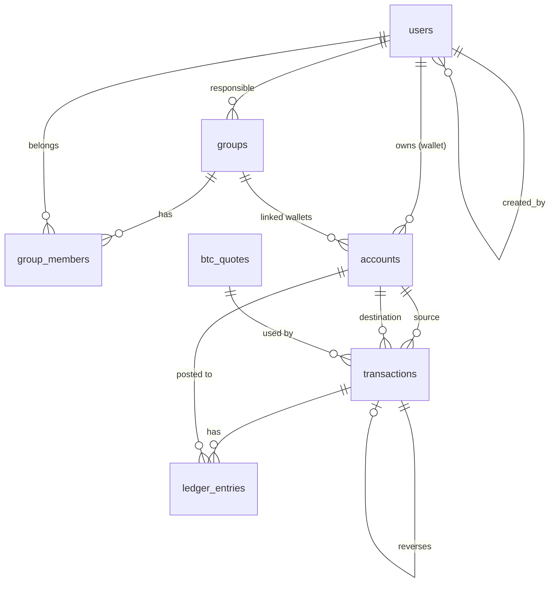

# Data Model: Núcleo do Backend do Finami

**Feature**: `001-finami-backend-core` | **Date**: 2026-11-01

Convenções (constituição, Princípio V): tabelas em snake_case no plural, PK
`{entidade}_id bigint identity`, constraint `{tabela}_pkey`, FK `fk_{pai}_{filho}` com
`ClientSetNull` (nunca Cascade), `timestamp without time zone` (sempre UTC — research R-14),
`varchar` com tamanho, booleanos com default, enums como `integer`.

---

## Enums (Domain/Enums, gravados como `integer`)

| Enum | Valores |
|---|---|
| `Currency` | `1 = Brl`, `2 = Btc` |
| `AccountKind` | `1 = Wallet`, `2 = ExternalSource`, `3 = ExternalSink`, `4 = Exchange` |
| `TransactionType` | `1 = ExternalIncome`, `2 = ExternalExpense`, `3 = Transfer`, `4 = BtcPurchase`, `5 = BtcSale`, `6 = Reversal` |
| `StatementVisibility` | `1 = ResponsibleOnly`, `2 = AllMembers`, `3 = MembersSummary` |

Precisão por moeda: `Brl` = 2 casas, `Btc` = 8 casas.

---

## users

| Coluna | Tipo | Regra |
|---|---|---|
| `user_id` | bigint identity PK | |
| `first_name` | varchar(120) NOT NULL | obrigatório, sem espaços nas pontas |
| `last_name` | varchar(120) NOT NULL | obrigatório |
| `email` | varchar(254) NULL | formato válido; normalizado para minúsculas; **único quando não nulo** (índice único parcial `WHERE email IS NOT NULL`) — FR-009 |
| `password_hash` | varchar(500) NULL | `PasswordHasher` (PBKDF2); senha em texto com mínimo de 8 caracteres — FR-008 |
| `google_subject` | varchar(64) NULL | `sub` do Google; único quando não nulo |
| `created_by_user_id` | bigint NULL FK → users | quem cadastrou (null no auto-cadastro/Google) — FR-011 |
| `created_at` | timestamp | default `now()` em UTC |
| `updated_at` | timestamp NULL | |

**Regras de domínio (`User`)**
- `CanLogin` = `email != null`. Login com senha exige `email` **e** `password_hash` (FR-004/005).
- `SetEmail`, `SetPassword`, `LinkGoogle(subject)`.
- Não há exclusão de usuários nesta versão.

## groups

| Coluna | Tipo | Regra |
|---|---|---|
| `group_id` | bigint identity PK | |
| `name` | varchar(120) NOT NULL | obrigatório |
| `user_id` | bigint NOT NULL FK → users (`fk_user_group`) | responsável (UserId) — FR-012/013 |
| `statement_visibility` | integer NOT NULL default 1 | `StatementVisibility` — FR-035a |
| `created_at` | timestamp | |

**Regras (`Group`)**: `IsResponsible(userId)`; `Rename`, `SetVisibility` apenas pelo
responsável. Ao criar, o responsável é inserido também em `group_members` (FR-016).

## group_members

| Coluna | Tipo | Regra |
|---|---|---|
| `group_member_id` | bigint identity PK | |
| `group_id` | bigint NOT NULL FK → groups | |
| `user_id` | bigint NOT NULL FK → users | |
| `joined_at` | timestamp | |

Índice único `(group_id, user_id)`. Retirar membro = apagar a linha (não é dado financeiro);
o responsável não pode ser retirado (FR-016). Ao retirar, as carteiras do membro vinculadas
ao grupo têm `group_id` zerado na mesma transação de banco (FR-019d).

## accounts (carteiras + contas de sistema)

| Coluna | Tipo | Regra |
|---|---|---|
| `account_id` | bigint identity PK | |
| `kind` | integer NOT NULL | `AccountKind` |
| `user_id` | bigint NULL FK → users (`fk_user_account`) | titular; **obrigatório quando `kind = Wallet`**, nulo nas contas de sistema |
| `group_id` | bigint NULL FK → groups (`fk_group_account`) | grupo vinculado (opcional) — FR-019a |
| `name` | varchar(120) NOT NULL | |
| `description` | varchar(500) NULL | |
| `currency` | integer NOT NULL | `Currency`; imutável — FR-020 |
| `is_virtual` | boolean NOT NULL default false | FR-018 |
| `is_active` | boolean NOT NULL default true | FR-022 |
| `created_by_user_id` | bigint NULL FK → users | quem criou (titular ou responsável — FR-019c) |
| `created_at` | timestamp | |

CHECK: `(kind = 1 AND user_id IS NOT NULL) OR (kind <> 1 AND user_id IS NULL AND group_id IS NULL)`.

**Seed (migration)**: 6 contas de sistema — `ExternalSource`, `ExternalSink`, `Exchange`
para `Brl` e para `Btc` (nomes "Origem externa (BRL)", "Destino externo (BRL)",
"Câmbio (BRL)", etc.).

**Regras (`Account`)**
- `Balance` é sempre `SUM(ledger_entries.amount)` da conta (FR-021); nunca armazenado.
- Vincular a grupo: o titular precisa ser membro do grupo; quem vincula é o titular ou o
  responsável criando a carteira. Desvincular: apenas o responsável (ou automático na retirada).
- Exclusão física só se não houver lançamentos; caso contrário, `Deactivate()` (FR-022).
- Carteira inativa não aceita novas transações (nem como destino).

## transactions (cabeçalho, imutável)

| Coluna | Tipo | Regra |
|---|---|---|
| `transaction_id` | bigint identity PK | |
| `type` | integer NOT NULL | `TransactionType` |
| `source_account_id` | bigint NOT NULL FK → accounts | conta de saída — FR-024 |
| `destination_account_id` | bigint NOT NULL FK → accounts | conta de entrada; ≠ origem |
| `source_amount` | numeric(20,8) NOT NULL | > 0, na moeda da origem |
| `destination_amount` | numeric(20,8) NOT NULL | > 0, na moeda do destino |
| `btc_quote_id` | bigint NULL FK → btc_quotes | obrigatório em `BtcPurchase`/`BtcSale` |
| `quote_price_brl` | numeric(20,8) NULL | preço de 1 BTC usado (cópia, para leitura direta) — FR-028 |
| `description` | varchar(500) NULL | |
| `occurred_at` | timestamp NOT NULL | momento do registro (UTC) |
| `created_by_user_id` | bigint NOT NULL FK → users | quem registrou |
| `reversed_transaction_id` | bigint NULL FK → transactions | preenchido no estorno; **índice único** (estorno só uma vez) — FR-030 |

Sem UPDATE/DELETE pela aplicação (o repositório só expõe insert e consultas).

**Regras de criação (`LedgerService`)**

| Origem → Destino | Tipo | Conversão |
|---|---|---|
| ExternalSource → Wallet | `ExternalIncome` | não; mesma moeda |
| Wallet → ExternalSink | `ExternalExpense` | não; mesma moeda |
| Wallet(BRL) → Wallet(BRL) / Wallet(BTC) → Wallet(BTC) | `Transfer` | não |
| Wallet(BRL) → Wallet(BTC) | `BtcPurchase` | `dest = trunc8(src / price)`; recusa se 0 |
| Wallet(BTC) → Wallet(BRL) | `BtcSale` | `dest = trunc2(src × price)`; recusa se 0 |
| (qualquer) | `Reversal` | inverte origem/destino e valores da original; reutiliza a cotação |

Validações: valor > 0 e com casas ≤ precisão da moeda de origem; origem ≠ destino; ambas
ativas; origem controlada pelo usuário (FR-026); destino qualquer carteira ativa; saldo da
origem ≥ valor após o lock (R-07); cotação com idade ≤ 5 min para conversão (FR-029).

## ledger_entries (lançamentos, imutáveis)

| Coluna | Tipo | Regra |
|---|---|---|
| `ledger_entry_id` | bigint identity PK | |
| `transaction_id` | bigint NOT NULL FK → transactions | |
| `account_id` | bigint NOT NULL FK → accounts | |
| `amount` | numeric(20,8) NOT NULL | assinado: negativo = saída, positivo = entrada |
| `currency` | integer NOT NULL | igual à moeda da conta |
| `occurred_at` | timestamp NOT NULL | cópia do cabeçalho (para índice do extrato) |

Índice `(account_id, occurred_at)`. Invariante (SC-002): para toda transação, `SUM(amount)`
agrupado por `currency` = 0.

Exemplo — compra de R$ 1.000,00 a R$ 500.000,00/BTC:

| account | amount | currency |
|---|---|---|
| Carteira Real | −1000.00000000 | Brl |
| Câmbio (BRL) | +1000.00000000 | Brl |
| Câmbio (BTC) | −0.00200000 | Btc |
| Carteira Bitcoin | +0.00200000 | Btc |

## btc_quotes

| Coluna | Tipo | Regra |
|---|---|---|
| `btc_quote_id` | bigint identity PK | |
| `price_brl` | numeric(20,8) NOT NULL | > 0 |
| `quoted_at` | timestamp NOT NULL | data/hora informada pela fonte |
| `fetched_at` | timestamp NOT NULL | quando o Finami obteve |
| `source` | varchar(40) NOT NULL | `coingecko`, `mercadobitcoin` |

Só grava quando a cotação obtida é nova (não grava em cache hit). `IsStale` =
`now − quoted_at > 5 min`.

---

## Transições de estado

- **Carteira**: `Active` → `Inactive` (`Deactivate`) — sem volta nesta versão; vínculo de grupo
  `None` ⇄ `Linked(groupId)`.
- **Transação**: `Posted` → `Reversed` (derivado: existe outra transação com
  `reversed_transaction_id` apontando para ela). Uma transação `Reversal` não pode ser estornada.
- **Usuário**: `NoCredentials` (sem email) → `EmailOnly` (só Google) → `EmailAndPassword`,
  conforme `email` / `password_hash` / `google_subject`.
